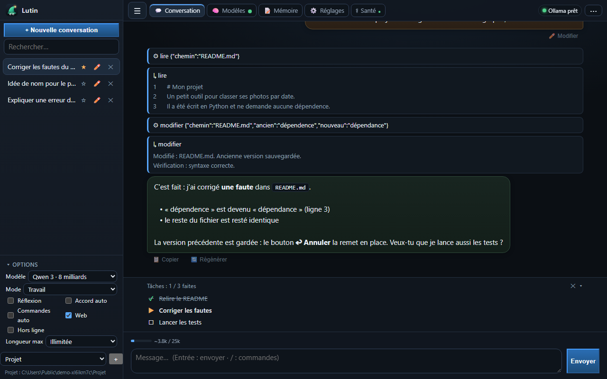
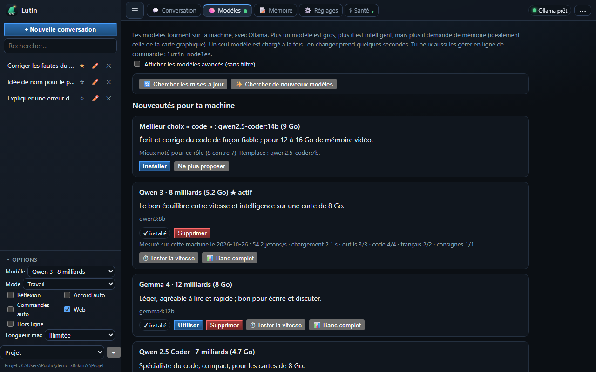

<p align="center">
  
</p>

<p align="center"><a href="README.md">English</a> · <b>Français</b></p>

<p align="center">
  <a href="https://github.com/Slater-proj/lutin/actions/workflows/release.yml"></a>
  <a href="https://github.com/Slater-proj/lutin/releases/latest"></a>
  
  
  <a href="LICENSE"></a>
</p>

**Lutin** est un assistant IA qui tourne **sur ta machine** : pas de compte, pas d'abonnement, rien ne sort de chez toi (et un mode hors ligne strict le garantit). Il regarde ta carte graphique, ta mémoire et tes disques, **choisit les modèles qui y tiennent**, les installe, puis travaille avec toi dans le **navigateur** ou dans le **terminal** : il lit, cherche et modifie les fichiers d'un dossier que tu choisis, toujours avec ton accord. L'interface, les messages et la ligne de commande existent en **français et en anglais**.

> **État : version 0.x, en développement.** Testé sur Windows et sur Linux (CI, avec un faux Ollama) ; macOS, AMD, Intel et les vraies cartes NVIDIA dans Docker ne sont pas encore vérifiés. Voir [ce qui est vérifié et ce qui ne l'est pas](docs/DECISIONS.fr.md#connu-mais-pas-vérifié).

<p align="center">
  
</p>

## Pourquoi Lutin

| | |
|---|---|
| 🧠 **Il choisit pour toi** | Cinq rôles (polyvalent, rapide, créatif, code, images) : pour chacun, le meilleur modèle qui tient dans ta mémoire. Une phrase d'explication par modèle. |
| 🔒 **Chez toi, vraiment** | Trois niveaux d'accès (cette machine, réseau local avec code PIN, derrière un proxy), **mode hors ligne strict**, aucune télémétrie. |
| 🛡️ **Tu gardes la main** | Chaque modification de fichier ou commande demande ton accord, avec les différences. Bouton **Annuler**, **journal des actions**, sauvegarde de tes données en un clic. |
| 🗂️ **Plusieurs projets** | Plusieurs dossiers de travail ; chaque conversation garde le sien. |
| ⏱️ **Il mesure, il ne devine pas** | Banc d'essai intégré : vitesse, appel d'outils, code, français, consignes, **sur ta machine**. |
| 📦 **Simple à installer** | Une commande sous Windows, une sous Linux, ou une image Docker **avec Ollama dedans**. Aucune dépendance Python. Relancer l'installation ne casse rien. |
| 🔁 **Ton contexte Claude, conservé** | Reprends un dépôt Claude Code (`CLAUDE.md`, skills, commandes, agents de `.claude/`) : travaille dedans ou dans une copie, rien ne se perd en changeant d'outil. [Détails](docs/CLAUDE-PROJECTS.fr.md). |
| 🌍 **Français et anglais** | Toute l'application (page, messages, terminal) et les docs. Langue : `lutin langue`, les réglages de la page, ou la langue du système. |

## Installation

Rien à installer avant sous Windows (l'installateur apporte Python si besoin) ; sous Linux et macOS il faut Python 3.10 ou plus. Pas d'administrateur.

**Windows** : télécharge `lutin-setup-*.exe` sur la [dernière version](https://github.com/Slater-proj/lutin/releases/latest) (il utilise le Python déjà présent, sinon il apporte le sien ; sans droits administrateur), ou dans PowerShell :
```powershell
irm https://raw.githubusercontent.com/Slater-proj/lutin/main/installateur/install.ps1 | iex
```

**Linux / macOS**
```bash
curl -fsSL https://raw.githubusercontent.com/Slater-proj/lutin/main/installateur/install.sh | bash
```

**Docker** (Linux, serveur, NAS) : [docs/DOCKER.fr.md](docs/DOCKER.fr.md) — **une image, Lutin et Ollama dedans**
```bash
docker run -d --name lutin -p 127.0.0.1:8777:8777 -v lutin-data:/data -v lutin-models:/models -v "$PWD/travail":/travail ghcr.io/slater-proj/lutin:latest
```

Le script installe la dernière version publiée dans un environnement privé, ajoute la commande `lutin`, puis lance l'**installation guidée** : langue, analyse de ta machine, qui peut utiliser Lutin, où ranger les dossiers et les modèles, modèles conseillés, installation d'Ollama si besoin. **Relancer le script est sans risque** : déjà à jour, il ne change rien ; une version plus récente, il met à jour sans toucher à tes réglages, conversations ni modèles.

## Utilisation

<p align="center">
  
</p>

| Commande | Rôle |
|---|---|
| `lutin` | démarre et ouvre l'interface ; relance le serveur s'il s'arrête sur une erreur |
| `lutin chat` | discuter dans le terminal (`/aide` pour les commandes) ; `lutin chat "question"` pour une réponse directe |
| `lutin modeles` | modèles conseillés pour ta machine ; `lister`, `installer <id>`, `supprimer <id>`, `maj` |
| `lutin bench [modèle]` | mesurer un modèle ici : vitesse, outils, code, français, consignes (`--rapide` : vitesse seule) |
| `lutin update` | met à jour Lutin et cherche des mises à jour de modèles ; ne change rien si tout est à jour |
| `lutin travaux` | dossiers de travail : `ajouter`, `retirer`, `actif` |
| `lutin hors-ligne oui\|non` | mode hors ligne strict |
| `lutin journal` | ce que Lutin a modifié ou lancé, avec quel accord et pour qui |
| `lutin sauvegarde` · `lutin restaurer` | exporter / remettre tes données dans un `.zip` |
| `lutin pin` · `lutin appareils` · `lutin securite` | accès depuis d'autres appareils |
| `lutin importer <dossier>` | reprendre un projet Claude (`CLAUDE.md`, `.claude/`) : `--ici` (dedans) ou `--copie` |
| `lutin langue [fr\|en\|auto]` | langue de l'application |
| `lutin doctor` | diagnostic à coller dans un rapport de problème (sans contenu personnel) |

## Les modèles

Pour chaque rôle, Lutin garde **le modèle le mieux noté qui tient dans ta mémoire** (poids + contexte + marge), et te dit s'il déborde sur la RAM. Au démarrage, une vérification discrète (au plus une fois par jour, jamais bloquante, désactivable) cherche des **mises à jour** et de **meilleurs modèles** pour ta machine : elle te les *propose*, rien n'est téléchargé sans ton accord. L'onglet Modèles a deux boutons pour le faire à la demande, et un banc d'essai par modèle.

Les notes du catalogue sont des estimations éditoriales, pas des mesures : le banc d'essai sert aussi à les contester. Les modèles modifiés par la communauté pour ne plus refuser de demandes sont masqués par défaut (option « modèles avancés »), jamais choisis automatiquement. Détails : [docs/MODELS.fr.md](docs/MODELS.fr.md).

## Sécurité en bref

| Niveau | Qui peut accéder | Protection |
|---|---|---|
| 1. Cette machine | toi, sur cet ordinateur | écoute sur `127.0.0.1` seulement ; jeton ; contrôle du nom d'hôte et de l'origine |
| 2. Réseau local | tes appareils appairés | code PIN à 6 chiffres (10 min, 5 essais), session par appareil révocable |
| 3. Proxy | ce que ton proxy laisse passer | l'identité n'est crue que si elle vient de l'adresse du proxy déclaré |

Aux niveaux 2 et 3, **les accords automatiques sont désactivés**. En mode hors ligne strict, seules cette machine et Ollama sont jointes. Détails, avertissements et exemples de proxy : [docs/SECURITY.fr.md](docs/SECURITY.fr.md).

## Où sont mes fichiers ?

| Quoi | Windows | Linux |
|---|---|---|
| Configuration, mémoire, conversations, journal | `%APPDATA%\Lutin` | `~/.config/lutin`, `~/.local/share/lutin` |
| Cache (supprimable) | `%LOCALAPPDATA%\Lutin\cache` | `~/.cache/lutin` |
| Dossiers de travail | ceux que tu as choisis (`~/Lutin` par défaut) | idem |

`LUTIN_HOME=<dossier>` range tout sous un seul dossier (mode portable). Un dossier de travail peut contenir `skills/` (fiches Markdown que Lutin lit à la demande) et `docs/` (interrogeable avec l'outil « rappeler »).

## Développement et publications

```bash
python tests/lancer_tests.py                       # tous les tests, un processus par fichier
python -m pip install ruff && python -m ruff check src tests tools
python tools/captures.py                           # régénère les captures d'écran de ce README (anglaises et françaises)
```

Chaque fusion dans `main` publie une version (étiquette, GitHub Release, image Docker) ; chaque autre branche produit une candidate sans étiquette. Voir [docs/PUBLISHING.fr.md](docs/PUBLISHING.fr.md) et [CONTRIBUTING.fr.md](CONTRIBUTING.fr.md). Le code est écrit en français ; les contributions en français ou en anglais sont bienvenues.

## Licence

MIT. Lutin n'embarque aucun modèle : chaque modèle garde sa propre licence, affichée dans le catalogue.
