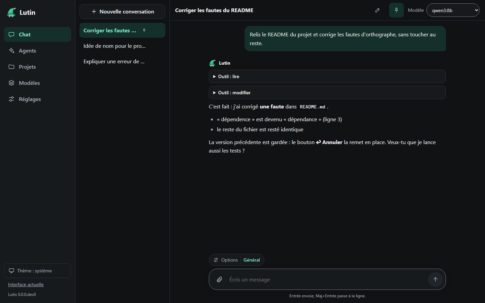
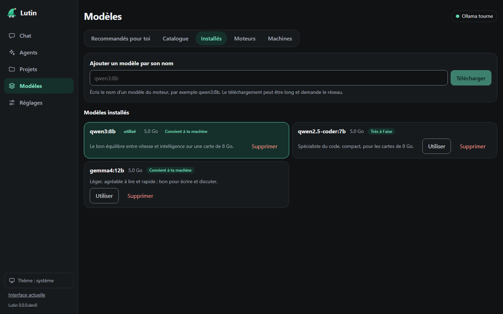
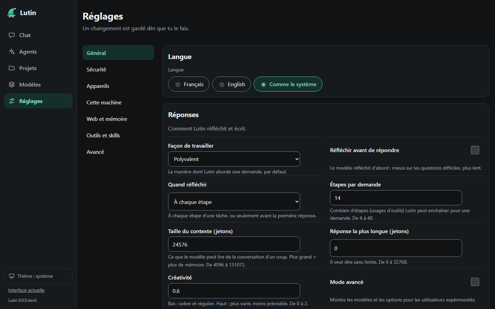
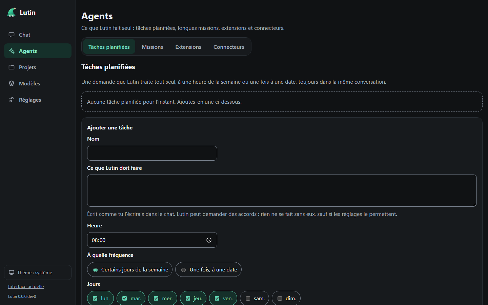

<p align="center">
  
</p>

<p align="center"><a href="README.md">English</a> · <b>Français</b></p>

<p align="center">
  <a href="https://github.com/Slater-proj/lutin/actions/workflows/release.yml?query=branch%3Amain"></a>
  <a href="https://github.com/Slater-proj/lutin/releases/latest"></a>
  
  
  <a href="LICENSE"></a>
</p>

**Lutin est un assistant IA qui tourne sur ton propre ordinateur.** Pas de compte, pas d'abonnement, pas de télémétrie : tes conversations, tes
fichiers et tes modèles restent chez toi, et un mode hors ligne strict le garantit. Lutin regarde ta carte graphique, ta mémoire et tes disques,
**choisit les modèles qui tiennent**, les installe avec le moteur qui les fait tourner, puis travaille avec toi dans le navigateur ou le terminal :
il lit, cherche et modifie les fichiers d'un dossier que tu choisis, **toujours avec ton accord**. En français et en anglais, de l'interface à la
ligne de commande.

<p align="center">
  
</p>

> **La version 1.0 est en préparation.** La nouvelle interface est celle par défaut, à `/` : les cinq espaces ci-dessous, sur une API
> versionnée (`/api/v1`), dans les deux langues, vérifiés dans un vrai navigateur et par des contrôles d'accessibilité automatiques. L'ancienne
> page et ses routes sont retirées ([ADR 0022](docs/adr/0022-the-old-page-goes-at-1.0.md)). Testé sous Windows et Linux ; macOS et les cartes AMD et
> Intel ne sont pas encore vérifiés : [ce qui est vérifié et ce qui ne l'est pas](docs/DECISIONS.fr.md#connu-mais-pas-vérifié).

## Pourquoi Lutin

| | |
|---|---|
| **Il choisit pour toi** | Pour chaque rôle (polyvalent, rapide, créatif, code, images), le meilleur modèle qui tient dans ta mémoire, avec une phrase pour dire pourquoi. Un banc d'essai intégré mesure la vitesse, les outils, le code et le respect des consignes **sur ta machine**, au lieu de deviner. |
| **Ton moteur, ton choix** | Ollama, llama.cpp, LM Studio, ExLlamaV3, Colibri ou tout serveur compatible OpenAI : Lutin les installe, les démarre, les met à jour et les compare, et ne propose que ceux qui peuvent tourner ici. |
| **Tu gardes la main** | Chaque modification de fichier et chaque commande attend ton accord, avec les différences sous les yeux. Annulation, journal des actions, règles pour ce qui peut tourner sans demander, sauvegarde en un clic. |
| **Chez toi, vraiment** | Trois niveaux d'accès (cette machine seulement, ton réseau local avec un code d'appairage, derrière ton proxy), mode hors ligne strict, aucune télémétrie, aucun compte. |
| **Tous tes ordinateurs, un seul assistant** | Appaire tes PC : utilise depuis ton portable les modèles de celui qui a la grosse carte graphique, reprends une conversation qu'il tient, réveille-le et éteins-le. Rien n'est accordé à distance : chaque droit est demandé, puis accepté sur la machine concernée. |
| **Il travaille pendant ton absence** | Tâches planifiées et longues missions menées seul, avec le résultat envoyé sur Gotify, ntfy, Telegram ou un webhook. |
| **Extensible, sans risque** | Connecteurs MCP, extensions (Telegram, mail, ComfyUI…) et skills tiers sont coupés tant que tu ne les actives pas, ne joignent que les sites qu'ils déclarent, et sont examinés avant que quoi que ce soit soit copié. |
| **Ton contexte, gardé** | Reprends un projet Claude Code (`CLAUDE.md`, `.claude/`) ou les données d'un autre assistant, une catégorie à la fois, sans rien écraser. |
| **Facile à installer** | Une commande sous Windows, une sous Linux, ou une image Docker avec Ollama dedans. Aucune dépendance Python ; relancer l'installation ne casse rien de ce qui marche. |

## Un aperçu de la nouvelle interface

Cinq espaces : **Chat**, **Agents**, **Projets**, **Modèles** et **Réglages**, pensés pour un téléphone tenu droit comme pour un écran de 2560 pixels.

<p align="center">
  
</p>

**Modèles** : un guide qui recommande un modèle selon ce que tu veux faire, tout le **catalogue** (à quoi sert chaque modèle, comment il tient sur ta machine, ce qu'il fait bien ou moins bien), ce qui est installé, les moteurs, et l'onglet **Machines** : les autres ordinateurs appairés, leur
état, leur séquence de réveil et les droits qu'ils accordent.

<p align="center">
  
</p>

**Réglages** en sept rubriques, une à la fois et gardée dans l'adresse ; sur un téléphone, la liste des rubriques puis celle que tu as choisie.
**Prêter cette machine** s'y trouve aussi : prêter son moteur, donner un code d'appairage, répondre aux droits que demandent les autres machines.

<p align="center">
  
</p>

**Agents** : tâches planifiées, missions, extensions et connecteurs, rangés comme les Réglages : une partie à la fois.

## Plusieurs ordinateurs, un seul assistant

Lutin sur ton portable peut utiliser le moteur du fixe qui a la carte graphique. Sur le fixe, **Réglages › Cette machine › Prêter cette machine**
donne un code à usage unique ; sur le portable, **Modèles › Machines** s'appaire avec. Ensuite :

- le Chat propose les modèles de chaque machine qui répond, sous son nom ; si elle s'éteint, cette machine répond à sa place, sans perdre un mot ;
- une conversation tenue par le fixe se poursuit depuis le portable, ses fichiers, ses outils et ses accords restant sur le fixe ;
- le fixe se réveille (Wake-on-LAN), se met à jour ou s'éteint depuis le portable, **seulement si son propriétaire l'a autorisé sur le fixe
  lui-même**.

Comment ça marche et ce qui passe sur le réseau : [docs/CLUSTER_ARCHITECTURE.fr.md](docs/CLUSTER_ARCHITECTURE.fr.md).

## Installation

Rien à installer avant sous Windows (l'installateur apporte Python si besoin) ; sous Linux et macOS il faut Python 3.10 ou plus. Aucun droit
administrateur.

**Windows** : `lutin-setup-*.exe` depuis la [dernière version](https://github.com/Slater-proj/lutin/releases/latest), ou dans PowerShell :
```powershell
irm https://raw.githubusercontent.com/Slater-proj/lutin/main/installateur/install.ps1 | iex
```

**Linux / macOS**
```bash
curl -fsSL https://raw.githubusercontent.com/Slater-proj/lutin/main/installateur/install.sh | bash
```

**Docker** (serveur, NAS) : une seule image, Lutin et Ollama dedans — [docs/DOCKER.fr.md](docs/DOCKER.fr.md)
```bash
docker run -d --name lutin -p 127.0.0.1:8777:8777 -v lutin-data:/data -v lutin-models:/models -v "$PWD/workspace":/workspace ghcr.io/slater-proj/lutin:latest
```

L'installateur met la dernière version dans un environnement à part, ajoute la commande `lutin`, puis lance l'**installation guidée** : langue,
examen de ta machine, qui peut utiliser Lutin, où vont les dossiers et les modèles, les modèles recommandés, et le moteur si besoin. Le relancer
ne risque rien : à jour, il ne change rien ; sinon il met à jour sans toucher à tes réglages, tes conversations ni tes modèles.

## Dans le terminal

| Commande | Rôle |
|---|---|
| `lutin` | démarre Lutin et l'ouvre dans le navigateur |
| `lutin chat` | discuter dans le terminal ; `lutin chat "question"` pour une réponse directe |
| `lutin models` | les modèles recommandés pour ta machine, installer, retirer, mettre à jour |
| `lutin bench [modèle]` | mesurer un modèle ici : vitesse, outils, code, français, consignes |
| `lutin update` | mettre Lutin à jour et chercher les mises à jour des modèles |
| `lutin offline on\|non` | mode hors ligne strict |
| `lutin log` | ce que Lutin a modifié ou lancé, avec quel accord et pour qui |
| `lutin backup` · `lutin restore` | exporter ou remettre tes données en `.zip` |
| `lutin pin` · `lutin devices` · `lutin security` | l'accès depuis tes autres appareils |
| `lutin import-project <dossier>` | reprendre un projet Claude |
| `lutin migrate <dossier ou .zip>` | reprendre les données d'un autre assistant |
| `lutin language [fr\|en\|auto]` | la langue de l'application |
| `lutin doctor` | un diagnostic à coller dans un signalement (sans contenu personnel) |

## La sécurité en bref

| Niveau | Qui peut joindre Lutin | Protection |
|---|---|---|
| 1. Cette machine | toi, sur cet ordinateur | écoute sur `127.0.0.1` seulement ; jeton de page ; nom d'hôte et origine vérifiés |
| 2. Réseau local | les appareils que tu as appairés | un code d'appairage à 6 chiffres (10 min, 5 essais), une session par appareil, révocable |
| 3. Proxy | ce que ton proxy laisse passer | une identité n'est crue que si elle vient de l'adresse du proxy que tu as déclarée |

Aux niveaux 2 et 3, les accords automatiques sont coupés. En mode hors ligne strict, seuls cette machine et son moteur sont joints. Le détail :
[docs/SECURITY.fr.md](docs/SECURITY.fr.md) · ce qui a été revu et ce qui reste ouvert : [docs/SECURITY_AUDIT.fr.md](docs/SECURITY_AUDIT.fr.md) ·
ce que Lutin peut contacter : [docs/PRIVACY.fr.md](docs/PRIVACY.fr.md) · mettre à jour et revenir en arrière : [docs/ROLLBACK.fr.md](docs/ROLLBACK.fr.md).

## Où sont mes fichiers ?

| Quoi | Windows | Linux |
|---|---|---|
| Configuration, mémoire, conversations, journal | `%APPDATA%\Lutin` | `~/.config/lutin`, `~/.local/share/lutin` |
| Cache (peut être supprimé) | `%LOCALAPPDATA%\Lutin\cache` | `~/.cache/lutin` |
| Dossiers de travail | ceux que tu as choisis (`~/Lutin` par défaut) | idem |

`LUTIN_HOME=<dossier>` met tout dans un seul dossier (mode portable).

## Documentation

Tout, par sujet : [docs/README.fr.md](docs/README.fr.md) — ce que fait Lutin ([FEATURES](docs/FEATURES.fr.md)), les modèles
([MODELS](docs/MODELS.fr.md)), Docker ([DOCKER](docs/DOCKER.fr.md)), plusieurs ordinateurs ([CLUSTER_ARCHITECTURE](docs/CLUSTER_ARCHITECTURE.fr.md)),
les vérifications sur du vrai matériel ([VALIDATION](docs/VALIDATION.fr.md)).

## Construire et contribuer

```bash
python tests/lancer_tests.py                        # tous les tests, un processus par fichier (Chrome sert s'il est installé)
python -m pip install ruff && python -m ruff check src tests tools
cd frontend && npm ci --ignore-scripts && npm run check && npm test && npm run build   # la nouvelle interface, dans src/lutin/web/app/
python tools/captures.py                            # les captures de cette page, depuis un serveur de démonstration sans aucune donnée réelle
```

Le chemin vers la 1.0 est écrit : [le plan de modernisation](docs/modernization/PLAN.md), [la nouvelle interface](docs/modernization/INTERFACE.md),
[l'API versionnée](docs/modernization/API_V1.md) et [les décisions](docs/adr/README.md) (en anglais, comme tout le dépôt à partir de la 1.0). Chaque
fusion dans `main` publie une version (étiquette, GitHub Release, images Docker) : [docs/PUBLISHING.fr.md](docs/PUBLISHING.fr.md). Les
contributions en français ou en anglais sont bienvenues : [CONTRIBUTING.fr.md](CONTRIBUTING.fr.md).

## Licence

MIT. Lutin n'embarque aucun modèle : chaque modèle garde sa propre licence, affichée dans le catalogue.
