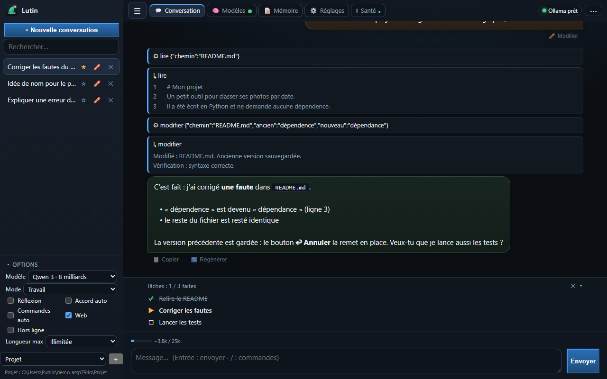
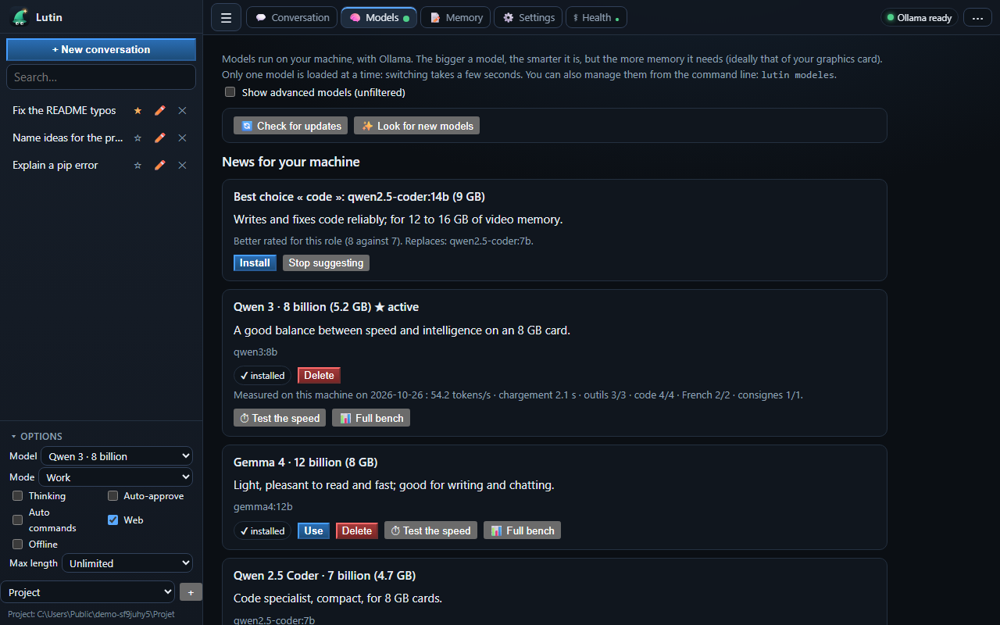

<p align="center">
  
</p>

<p align="center"><b>English</b> · <a href="README.fr.md">Français</a></p>

<p align="center">
  <a href="https://github.com/Slater-proj/lutin/actions/workflows/release.yml"></a>
  <a href="https://github.com/Slater-proj/lutin/releases/latest"></a>
  
  
  <a href="LICENSE"></a>
</p>

**Lutin** is an AI assistant that runs **on your machine**: no account, no subscription, nothing leaves your place (and a strict offline mode guarantees it). It looks at your graphics card, your memory and your disks, **picks the models that fit**, installs them, then works with you in the **browser** or in the **terminal**: it reads, searches and modifies the files of a folder you choose, always with your approval. The interface, the messages and the command line are available in **English and French**.

> **Status: version 0.x, under development.** Tested on Windows and on Linux (CI, with a fake Ollama); macOS, AMD, Intel and real NVIDIA cards in Docker are not verified yet. See [what is verified and what is not](docs/DECISIONS.md#known-but-not-verified).

<p align="center">
  
</p>

## Why Lutin

| | |
|---|---|
| 🧠 **It chooses for you** | Five roles (general, fast, creative, code, images): for each one, the best model that fits in your memory. One sentence of explanation per model. |
| 🔒 **At home, really** | Three access levels (this machine, local network with a PIN code, behind a proxy), **strict offline mode**, no telemetry. |
| 🛡️ **You stay in control** | Every file change or command asks for your approval, with the differences. **Undo** button, **action log**, one-click backup of your data. |
| 🗂️ **Several projects** | Several workspace folders; each conversation keeps its own. |
| ⏱️ **It measures, it does not guess** | Built-in benchmark: speed, tool calls, code, French, instructions, **on your machine**. |
| 📦 **Easy to install** | One command on Windows, one on Linux, or a Docker image **with Ollama inside**. No Python dependency. Running the installation again breaks nothing. |
| 🔁 **Your Claude context, kept** | Take over a Claude Code repository (`CLAUDE.md`, `.claude/` skills, commands, agents): work in it or in a copy, nothing is lost when switching tools. [Details](docs/CLAUDE-PROJECTS.md). |
| 📥 **Bring your old assistant** | `lutin reprendre`: take over conversations, memory, skills and settings of another assistant, one category at a time, nothing overwritten. [Details](docs/MIGRATION.md). |
| 🌍 **English and French** | The whole application (page, messages, terminal) and the docs. Language: `lutin langue`, the page settings, or the system language. |

## Installation

Nothing to install first on Windows (the installer brings Python if needed); on Linux and macOS you need Python 3.10 or more. No administrator rights.

**Windows**: download `lutin-setup-*.exe` from the [latest release](https://github.com/Slater-proj/lutin/releases/latest) (it uses the Python you already have, otherwise it brings its own; no administrator rights), or in PowerShell:
```powershell
irm https://raw.githubusercontent.com/Slater-proj/lutin/main/installateur/install.ps1 | iex
```

**Linux / macOS**
```bash
curl -fsSL https://raw.githubusercontent.com/Slater-proj/lutin/main/installateur/install.sh | bash
```

**Docker** (Linux, server, NAS): [docs/DOCKER.md](docs/DOCKER.md) — **one image, Lutin and Ollama inside**
```bash
docker run -d --name lutin -p 127.0.0.1:8777:8777 -v lutin-data:/data -v lutin-models:/models -v "$PWD/travail":/travail ghcr.io/slater-proj/lutin:latest
```

The script installs the latest published version in a private environment, adds the `lutin` command, then starts the **guided installation**: language, analysis of your machine, who can use Lutin, where to put the folders and models, recommended models, Ollama installation if needed. **Running the script again is safe**: if up to date, it changes nothing; if a newer version exists, it updates without touching your settings, conversations or models.

## Usage

<p align="center">
  
</p>

| Command | Role |
|---|---|
| `lutin` | starts and opens the interface; restarts the server if it stops on an error |
| `lutin chat` | chat in the terminal (`/aide` for the commands); `lutin chat "question"` for a direct answer |
| `lutin modeles` | models recommended for your machine; `lister`, `installer <id>`, `supprimer <id>`, `maj` |
| `lutin bench [model]` | measure a model here: speed, tools, code, French, instructions (`--rapide`: speed only) |
| `lutin update` | updates Lutin and looks for model updates; changes nothing if everything is up to date |
| `lutin travaux` | workspace folders: `ajouter`, `retirer`, `actif` |
| `lutin hors-ligne oui\|non` | strict offline mode |
| `lutin journal` | what Lutin modified or ran, with which approval and for whom |
| `lutin sauvegarde` · `lutin restaurer` | export / put back your data in a `.zip` |
| `lutin pin` · `lutin appareils` · `lutin securite` | access from other devices |
| `lutin importer <folder>` | take over a Claude project (`CLAUDE.md`, `.claude/`): `--ici` (in it) or `--copie` (in a copy) |
| `lutin reprendre <folder or .zip>` | take over another assistant's data: `--conversations --memoire --skills --reglages` |
| `lutin langue [fr\|en\|auto]` | language of the application |
| `lutin doctor` | diagnostics to paste into a problem report (no personal content) |

Beyond chatting: test your PC, dry run, search your PDF and Word documents offline, scheduled tasks, images, phone pairing with a QR code. See [docs/FEATURES.md](docs/FEATURES.md).

The command names are French (the project is written in French first); `lutin --help` explains them in your language.

## The models

For each role, Lutin keeps **the best rated model that fits in your memory** (weights + context + margin), and tells you if it spills over into RAM. At startup, a discreet check (at most once a day, never blocking, can be turned off) looks for **updates** and **better models** for your machine: it *proposes* them, nothing is downloaded without your approval. The Models tab has two buttons to do it on demand, and a benchmark per model.

The catalogue's ratings are editorial estimates, not measurements: the benchmark is also there to challenge them. Models modified by the community so that they no longer refuse requests are hidden by default (« advanced models » option), never chosen automatically. Details: [docs/MODELS.md](docs/MODELS.md).

## Security in brief

| Level | Who can access | Protection |
|---|---|---|
| 1. This machine | you, on this computer | listens on `127.0.0.1` only; token; host name and origin check |
| 2. Local network | your paired devices | 6-digit PIN code (10 min, 5 attempts), revocable session per device |
| 3. Proxy | what your proxy lets through | the identity is only trusted if it comes from the declared proxy address |

At levels 2 and 3, **automatic approvals are turned off**. In strict offline mode, only this machine and Ollama are reached. Details, warnings and proxy examples: [docs/SECURITY.md](docs/SECURITY.md). What Lutin may contact on the network, and how to turn it off: [docs/PRIVACY.md](docs/PRIVACY.md).

## Where are my files?

| What | Windows | Linux |
|---|---|---|
| Configuration, memory, conversations, log | `%APPDATA%\Lutin` | `~/.config/lutin`, `~/.local/share/lutin` |
| Cache (can be deleted) | `%LOCALAPPDATA%\Lutin\cache` | `~/.cache/lutin` |
| Workspace folders | the ones you chose (`~/Lutin` by default) | same |

`LUTIN_HOME=<folder>` puts everything under a single folder (portable mode). A workspace folder can contain `skills/` (Markdown sheets Lutin reads on demand) and `docs/` (searchable with the « rappeler » tool).

## Development and releases

```bash
python tests/lancer_tests.py                       # all the tests, one process per file
python -m pip install ruff && python -m ruff check src tests tools
python tools/captures.py                           # regenerates the screenshots of this README (English and French)
```

Every merge into `main` publishes a version (tag, GitHub Release, Docker images); every other branch produces a candidate without a tag. See [docs/PUBLISHING.md](docs/PUBLISHING.md) and [CONTRIBUTING.md](CONTRIBUTING.md). The code is written in French; contributions in English or French are welcome.

## Licence

MIT. Lutin ships no model: each model keeps its own licence, shown in the catalogue.
