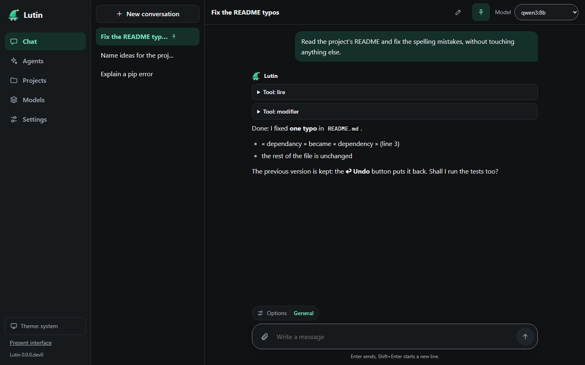
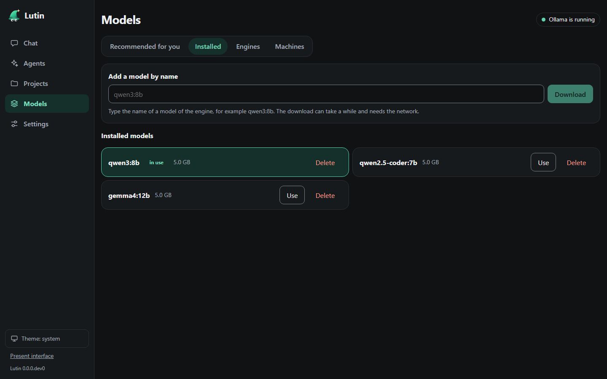
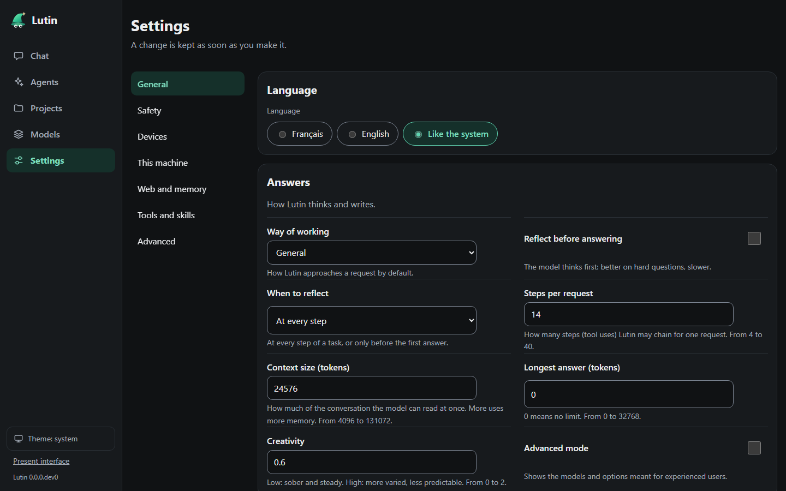
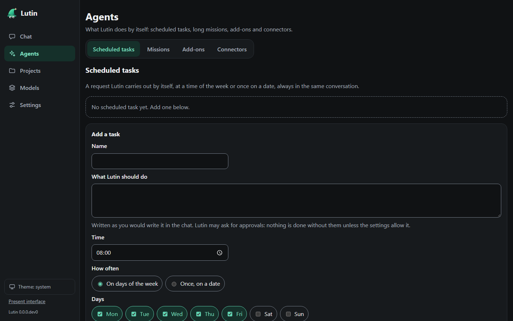

<p align="center">
  
</p>

<p align="center"><b>English</b> · <a href="README.fr.md">Français</a></p>

<p align="center">
  <a href="https://github.com/Slater-proj/lutin/actions/workflows/ci.yml"></a>
  <a href="https://github.com/Slater-proj/lutin/releases/latest"></a>
  
  
  <a href="LICENSE"></a>
</p>

**Lutin is an AI assistant that runs on your own computer.** No account, no subscription, no telemetry: your conversations, your files and your
models stay at home, and a strict offline mode guarantees it. Lutin looks at your graphics card, memory and disks, **chooses the models that fit**,
installs them and the engine that runs them, then works with you in the browser or the terminal: it reads, searches and changes the files of a
folder you choose, **always with your approval**. In English and French, from the interface to the command line.

<p align="center">
  
</p>

> **Version 1.0 is in preparation.** The new interface is the default at `/`: the five areas below, on a versioned API (`/api/v1`), in
> both languages, checked in a real browser and by automatic accessibility tests. The previous page stays at `/ancienne/` during the 1.x
> versions and goes in 2.0. Tested on Windows and Linux; macOS, AMD and Intel cards are not verified yet:
> [what is verified and what is not](docs/DECISIONS.md#known-but-not-verified).

## Why Lutin

| | |
|---|---|
| **It chooses for you** | For each role (general, fast, creative, code, images), the best model that fits in your memory, with one sentence on why. A built-in benchmark measures speed, tool use, code and instructions **on your machine** instead of guessing. |
| **Your engine, your choice** | Ollama, llama.cpp, LM Studio, ExLlamaV3, Colibri or any OpenAI-compatible server: Lutin installs, starts, updates and compares them, and offers only those that can run here. |
| **You stay in control** | Every file change and every command waits for your approval, with the differences shown. Undo, an action log, rules for what may run without asking, one-click backups. |
| **At home, really** | Three access levels (this machine only, your local network with a pairing code, behind your proxy), strict offline mode, no telemetry, no account. |
| **All your computers, one assistant** | Pair your PCs: use the models of the one with the big graphics card from your laptop, continue a conversation it holds, wake it up and switch it off. Nothing is granted from afar: each right is asked, then accepted on the machine concerned. |
| **It works while you are away** | Scheduled tasks and long missions carried out alone, with the result sent to Gotify, ntfy, Telegram or a webhook. |
| **Extensible, safely** | MCP connectors, add-ons (Telegram, mail, ComfyUI…) and third-party skills are off until you turn them on, reach only the sites they declare, and are looked into before anything is copied. |
| **Your context, kept** | Take over a Claude Code project (`CLAUDE.md`, `.claude/`) or the data of another assistant, one category at a time, nothing overwritten. |
| **Easy to install** | One command on Windows, one on Linux, or one Docker image with Ollama inside. No Python dependency; running the installer again changes nothing that works. |

## A look at the new interface

Five areas: **Chat**, **Agents**, **Projects**, **Models** and **Settings**, laid out for a phone held upright as well as for a 2560-pixel screen.

<p align="center">
  
</p>

**Models**: a guide that recommends a model for what you want to do, the whole **catalogue** (what each model is for, how it fits your machine, what it is good and less good at), what is installed, the engines, and the **Machines** tab: the other computers you paired, their state, their
wake-up sequence, and the rights they grant.

<p align="center">
  
</p>

**Settings** in seven sections, one at a time and kept in the address; on a phone, the list of sections and then the one you chose. **Lend this
machine** is there too: lend its engine, give a pairing code, answer the rights other machines ask for.

<p align="center">
  
</p>

**Agents**: scheduled tasks, missions, add-ons and connectors, laid out as Settings: one part at a time.

## Several computers, one assistant

Lutin on your laptop can use the engine of the desktop that has the graphics card. On the desktop, **Settings › This machine › Lend this machine**
gives a one-time code; on the laptop, **Models › Machines** pairs with it. From then on:

- the Chat offers the models of each machine that answers, under its name; if it goes off, this machine answers instead, without a word lost;
- a conversation held by the desktop can be continued from the laptop, with its files, tools and approvals staying on the desktop;
- the desktop can be woken up (Wake-on-LAN), updated or switched off from the laptop, **only if its owner allowed it on the desktop itself**.

How it works and what crosses the network: [docs/CLUSTER_ARCHITECTURE.md](docs/CLUSTER_ARCHITECTURE.md).

## Installation

Nothing to install first on Windows (the installer brings Python if needed); on Linux and macOS you need Python 3.10 or later. No administrator
rights.

**Windows**: `lutin-setup-*.exe` from the [latest release](https://github.com/Slater-proj/lutin/releases/latest), or in PowerShell:
```powershell
irm https://raw.githubusercontent.com/Slater-proj/lutin/main/installateur/install.ps1 | iex
```

**Linux / macOS**
```bash
curl -fsSL https://raw.githubusercontent.com/Slater-proj/lutin/main/installateur/install.sh | bash
```

**Docker** (server, NAS): one image, Lutin and Ollama inside — [docs/DOCKER.md](docs/DOCKER.md)
```bash
docker run -d --name lutin -p 127.0.0.1:8777:8777 -v lutin-data:/data -v lutin-models:/models -v "$PWD/workspace":/workspace ghcr.io/slater-proj/lutin:latest
```

The installer puts the latest version in a private environment, adds the `lutin` command, then starts the **guided setup**: language, a look at
your machine, who may use Lutin, where the folders and models go, the recommended models, and the engine if needed. Running it again is safe: up
to date, it changes nothing; otherwise it updates without touching your settings, conversations or models.

## In the terminal

| Command | Role |
|---|---|
| `lutin` | starts Lutin and opens it in the browser (the previous page stays at `/ancienne/` during 1.x) |
| `lutin chat` | chat in the terminal; `lutin chat "question"` for a direct answer |
| `lutin models` | the models recommended for your machine, install, remove, update |
| `lutin bench [model]` | measure a model here: speed, tools, code, French, instructions |
| `lutin update` | update Lutin and look for model updates |
| `lutin offline on\|non` | strict offline mode |
| `lutin log` | what Lutin changed or ran, with which approval and for whom |
| `lutin backup` · `lutin restore` | export or put back your data as a `.zip` |
| `lutin pin` · `lutin devices` · `lutin security` | access from your other devices |
| `lutin import-project <folder>` | take over a Claude project |
| `lutin migrate <folder or .zip>` | take over the data of another assistant |
| `lutin language [fr\|en\|auto]` | the language of the application |
| `lutin doctor` | a diagnosis to paste into a problem report (no personal content) |

Some command names are still French (the project was written in French first and is moving to English for 1.0); `lutin --help` explains them in
your language.

## Security in brief

| Level | Who can reach Lutin | Protection |
|---|---|---|
| 1. This machine | you, on this computer | listens on `127.0.0.1` only; page token; host name and origin checked |
| 2. Local network | the devices you paired | a 6-digit pairing code (10 min, 5 attempts), a session per device you can revoke |
| 3. Proxy | what your proxy lets through | an identity is trusted only from the proxy address you declared |

At levels 2 and 3 the automatic approvals are off. In strict offline mode only this machine and its engine are reached. Details:
[docs/SECURITY.md](docs/SECURITY.md) · what was reviewed and what is open: [docs/SECURITY_AUDIT.md](docs/SECURITY_AUDIT.md) · what Lutin may
contact: [docs/PRIVACY.md](docs/PRIVACY.md) · updating and going back: [docs/ROLLBACK.md](docs/ROLLBACK.md).

## Where are my files?

| What | Windows | Linux |
|---|---|---|
| Configuration, memory, conversations, log | `%APPDATA%\Lutin` | `~/.config/lutin`, `~/.local/share/lutin` |
| Cache (can be deleted) | `%LOCALAPPDATA%\Lutin\cache` | `~/.cache/lutin` |
| Workspace folders | the ones you chose (`~/Lutin` by default) | same |

`LUTIN_HOME=<folder>` puts everything in a single folder (portable mode).

## Documentation

Everything by topic: [docs/README.md](docs/README.md) — what Lutin does ([FEATURES](docs/FEATURES.md)), the models ([MODELS](docs/MODELS.md)),
Docker ([DOCKER](docs/DOCKER.md)), several computers ([CLUSTER_ARCHITECTURE](docs/CLUSTER_ARCHITECTURE.md)), a step-by-step trial
([GUIDE-ESSAI](docs/GUIDE-ESSAI.md)).

## Building and contributing

```bash
python tests/lancer_tests.py                        # every test, one process per file (Chrome is used when it is installed)
python -m pip install ruff && python -m ruff check src tests tools
cd frontend && npm ci --ignore-scripts && npm run check && npm test && npm run build   # the new interface, into src/lutin/web/app/
python tools/captures.py                            # the screenshots of this page, from a demonstration server with no real data
```

The way to 1.0 is written down: [the modernization plan](docs/modernization/PLAN.md), [the new interface](docs/modernization/INTERFACE.md),
[the versioned API](docs/modernization/API_V1.md) and [the decision records](docs/adr/README.md). Every merge into `main` publishes a version (tag,
GitHub Release, Docker images): [docs/PUBLISHING.md](docs/PUBLISHING.md). Contributions in English or French are welcome:
[CONTRIBUTING.md](CONTRIBUTING.md).

## Licence

MIT. Lutin ships no model: each model keeps its own licence, shown in the catalogue.
